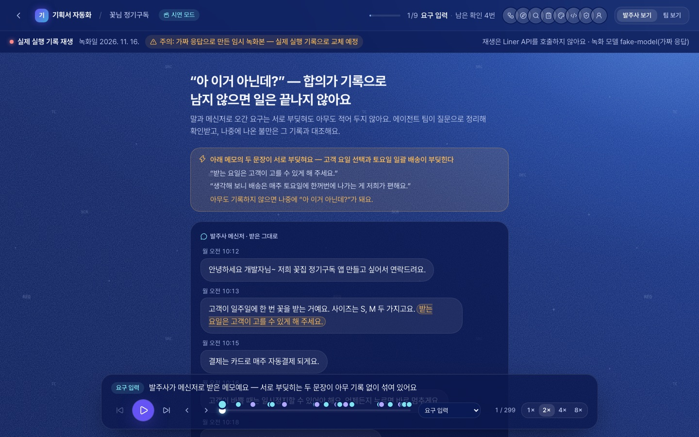

# 0to1(영일) — 라이너 .EXE-THON 2026 출품작

말로 던진 요구(0)를 확인받은 첫 판(1)으로.

> **“아 이거 아닌데?”** — 말과 메신저로 받은 요구는 명세로 남지 않는다.
> 그래서 발주사가 결과물을 보고 다르다고 할 때 누구 말이 맞는지 확인할 기록이 없고, 일은 끝나지 않는다.
> 에이전트 팀이 요구를 질문으로 정리해 **확인받은 기록**을 남기고, 나중의 변경·불만은 그 기록과 대조한다.



| 문서 | 내용 |
|---|---|
| [사용 가이드](docs/사용_가이드.md) | 설치부터 실제 모드 한 바퀴, 결과물 내려받기, 문제 해결까지 화면 사진과 함께 |
| [기획서 (PDF)](docs/기획서.pdf) | 문제 · 해결 방식 · Liner API 활용 · 확장 가능성 (원문 [md](docs/plans/2026-11-23_엑스톤_기획서.md)) |
| 아래 「실행 방법」 | 심사용 키로 바로 실행하는 최소 절차 |

역할이 다른 에이전트 7명(조율자·FDE 리드·리서처·PM·디자이너·개발자·QA)과 소비자 에이전트가 관계도(`teams/default.json`)에 그려진 선을 따라서만 대화한다. 발주사(사람)는 질문 카드에 답하고 **기본 확인 4번 + 바꿀 때마다 1번(CP5)** 으로 확정하며, 팀은 문서 4종(BRD·PRD·화면설계서·테스트 케이스)과 프로토타입(앱이면 폰 기기별, 웹이면 데스크톱부터 모바일까지)을 만든다.

> 시연 소재 「꽃님」은 **가상의 꽃집**이며 실제 가게·회사·인물과 무관하다. 저장소의 예제·녹화·평가 데이터는 모두 직접 지어낸 가상 데이터다.

## 키 없이 1분 보기 (시연 모드)

1. `uv sync && uv run uvicorn app.main:create_app --factory --port 8000`
2. http://127.0.0.1:8000 → **시연 모드**
3. 첫 장면: 메신저 메모에서 서로 부딪히는 두 문장. 재생(스페이스)이나 `]`(다음 장면)로 질문 → 확인 → 문서 4종 → 프로토타입 → 변경 영향(CP5) → 「아 이거 아닌데?」 판정까지 본다
4. 끝 장면에서 **시연 녹화본 내려받기(zip)** — 인쇄용 문서·프로토타입을 키 없이 열어 볼 수 있다

재생은 저장된 실행 기록(`demo/flower-run.json`)만 읽고 Liner 를 부르지 않는다. 화면 위 띠에 녹화본 종류(가짜 응답 임시본 / 실제 실행 기록 · 답한 모델 · 총 비용 · 걸린 시간)가 표시된다.

## 측정 결과 (2026-11-16, `LINER_MODEL=liner-claude-router`)

| 지표 | 무엇을 | 결과 (3회) | 목표 |
|---|---|---|---|
| M1 심은 결함 탐지 | `scripts/measure_m1.py` — 정답표 결함 10개 중 찾은 수 | 9 · 10 · 9 / 10 | 8 이상 |
| M2 변경 영향 재현율 | `scripts/measure_m2.py` — 변경 20건 | 1.000 · 1.000 · 1.000 | 0.9 이상 |
| 판정 정확도 (FR-22) | `scripts/measure_decisions.py` — 불만 20건, 판정 `typesafe/jev-1.13` | 1.00 · 1.00 · 1.00 | 0.9 이상 |
| 용도 검사 G9 (2026-11-18) | `scripts/measure_policy.py` — 해로운 요청 12건 + 함정 단어·경계 사례(전쟁 게임·도검 공방 등)가 든 정상 요청 16건(`eval/golden/policy_cases.json`) | 막음 12·12 / 12, 잘못 막음 0·0 / 16 (2회) | 막음 11 이상, 잘못 막음 1 이하 |
| QA 동작 규칙 점검 (2026-11-19) | QA 가 값 목록·세는 기준·단계 사이 입출력·시각 경계·값 없음을 `missing_rule` 로 지적(기존 3종 뒤, 최대 4건). 배송 지연 프로젝트 원문·요구사항으로 실제 QA 2회 + M1 2회 | 반복 질문 주제 2/5 → 5·5/5, M1 9·10 → 9·9 (같은 날 기준선) | 주제 늘고 M1 8 이상 유지 |
| 잡담 거르기 (2026-11-18) | `scripts/measure_hygiene.py` — 확정 뒤 잡담 변경 10건·잡담 불만 6건, 진짜 불만 20건(`eval/golden/hygiene_cases.json`) | 관련 없음 10/10 · 무관 6/6 · 진짜 불만을 버림 0/20, M2 대상 적중 20/20 그대로 | 9 이상 · 5 이상 · 1 이하 |

`--fake` 실행은 가짜 응답이라 지표가 아니다. 확신도 문턱(0.6)과 G7·G8 상한은 아직 제안값이다.

## 실행 방법

필요한 것: Python 3.12 이상과 [uv](https://docs.astral.sh/uv/). 화면은 미리 빌드된 정적 파일(`app/static/`)을 서버가 내보내므로 **실행만 할 때는 Node.js 가 필요 없다.**

### 1. 설치

```bash
uv sync
```

uv 가 없으면 pip 로도 설치할 수 있다. `requirements.txt` 는 `uv.lock` 에서 뽑은 것이라 버전이 같다.

```bash
python3 -m venv .venv
source .venv/bin/activate          # Windows: .venv\Scripts\activate
pip install -r requirements.txt
```

### 2. API 키 설정

저장소 루트에 `.env` 파일을 만들고 **필수 2개**를 넣는다. `.env`는 `.gitignore`에 있어 커밋되지 않는다.

```
LINER_API_KEY=<발급받은 키>
LINER_MODEL=liner-claude-router
```

| 필수 | 내용 |
|---|---|
| `LINER_API_KEY` | Liner Platform API 키 (https://platform.liner.com 에서 발급). 없으면 시연 모드만 쓸 수 있고, 실제 모드는 시작할 때 설정 방법이 적힌 오류를 낸다 |
| `LINER_MODEL` | 에이전트가 쓸 Liner 모델. 코드에 기본값은 없다. **권장 `liner-claude-router`** — 라우터는 실제로 답한 모델을 알려 주고 에이전트별 `routing_strategy`(`agents/*.json`)를 받는다. `liner-mark-1.3` 도 쓸 수 있다(그때는 `routing_strategy` 를 보내지 않는다) |

<details>
<summary>선택 변수 (권장값)</summary>

```
LINER_DECISION_MODEL=typesafe/jev-1.13
LINER_RERANK_MODEL=cohere/rerank-5-fast
LINER_STT_MODEL=openai/gpt-transcribe
LINER_IMAGE_MODEL=qwen/qwen-image-2.1-turbo
LINER_FILE_MODEL=google/gemini-3.8-flash
```

| 변수 | 내용 |
|---|---|
| `LINER_DECISION_MODEL` | 판정 기능의 Liner Decisions 모델. 없으면 「아 이거 아닌데?」는 「사람 판단 필요」로 표시되고, G1 보조 판정은 건너뛴다 |
| `LINER_RERANK_MODEL` | 변경 요청의 대상 요구사항 후보를 고르는 Rerank 모델. 없으면 PM 이 전체에서 고른다 |
| `LINER_STT_MODEL` | 회의 녹음 받아쓰기 모델. 없으면 녹음 올리기가 설정 방법이 적힌 오류를 낸다 |
| `LINER_IMAGE_MODEL` | 프로토타입 상품 사진 모델(권장 `qwen/qwen-image-2.1-turbo`). 없거나 실패하면 사진 자리를 그림으로 두고 CP4 에 참고 안내만 남긴다 |
| `LINER_FILE_MODEL` | 첨부 PDF 를 읽는 모델. 없으면 `google/gemini-3.8-flash`(라우터는 PDF 를 받지 않는다). 이미지는 `LINER_MODEL` 로 읽는다 |
| `EXETHON_DECISION_MIN_CONFIDENCE` | 판정 확신도가 이보다 낮으면 「사람 판단 필요」, 기본 0.6(제안값) |
| `EXETHON_MAX_COST_USD` | 한 프로젝트의 Liner 비용 상한(달러), 기본 꺼짐. 크레딧 잔액 차이로 재며 넘으면 멈추고 「계속」을 묻는다(G7) |
| `EXETHON_MAX_LINER_CALLS` | 한 프로젝트의 Liner 호출 상한, 기본 60 (G7) |
| `EXETHON_MAX_STAGE_SECONDS` | 작업 단계 하나의 시간 상한(초), 기본 600 (G7) |
| `EXETHON_MAX_SCREENS` | 화면 수 상한, 기본 5 — 넘는 요구는 범위 조정을 제안한다(G8) |
| `EXETHON_COMPANY` | 회사 작업 공간(개발 중 기능), 기본 꺼짐 — 꺼져 있으면 실제·시연 모드만 예전처럼 동작한다. `on` 이면 회사 선택과 회사 공통 자료·지난 결정·만든 서비스 이어받기가 켜진다 |
| `GITHUB_CLIENT_ID` | 「GitHub에 올리기」를 켜는 이 앱의 OAuth App Client ID(사용자 계정도 비밀값도 아니다). 등록: GitHub → Settings → Developer settings → OAuth Apps → New OAuth App(Homepage·Callback URL 은 아무 주소나 됨) → 앱 설정에서 **Enable Device Flow** 체크 → Client ID 를 `.env` 에 `GITHUB_CLIENT_ID=...` 로 넣는다. 사용자는 브라우저마다 화면에 뜬 코드를 github.com/login/device 에 넣어 **자기 계정**을 연결하고, 올리기는 그 계정으로 된다. 토큰은 브라우저 세션별로 서버 메모리에만 두며(12시간 안 쓰면 삭제) 저장·응답하지 않는다. 없으면 GitHub 버튼이 「내려받기(zip)로 받아 주세요」라고 안내한다 |

</details>

키는 호출할 때마다 읽으므로 서버를 켠 뒤에 `.env` 를 만들어도 된다.

### 3. 서버 실행

```bash
uv run uvicorn app.main:create_app --factory --port 8000
```

pip 로 설치했다면 가상환경을 켠 채로 `uvicorn app.main:create_app --factory --port 8000` 을 실행한다.

브라우저에서 http://127.0.0.1:8000 을 연다. 데이터는 `data/exethon.sqlite3` 에 저장된다.

- **시연 모드**: 키 없이 동작한다. 저장된 실행 기록(`demo/flower-run.json`)을 재생하며 Liner 를 호출하지 않는다. 화면 위 띠에 녹화본 종류가 표시된다
- **실제 모드**: 요청 메모를 붙여 넣고 질문 카드에 답하고 확인하면 팀이 실제 Liner 로 작업한다. 입력 칸의 **예제 메모 채우기**가 `examples/flower-subscription/request_memo.md` 본문을 넣어 준다. 시작 화면의 **최근 프로젝트**에서 저장된 프로젝트를 다시 연다
- **실제 실행을 시연 녹화로**: CP4 까지 마친 실제 프로젝트를 `uv run python scripts/export_demo.py --project <id> --out demo/flower-run.json` 으로 녹화본(kind real)으로 바꾼다. 답한 모델·총 비용·걸린 시간이 녹화 머리에 들어간다

### 개발자용 — 화면 다시 빌드·테스트

화면 코드(`frontend/`)를 고쳤을 때만 필요하다. Node.js 20 이상.

```bash
cd frontend && npm ci && npm run build   # app/static/ 에 결과물을 쓴다
uv run pytest                            # 백엔드 테스트 (실제 Liner 호출 없음)
```

화면 개발 중에는 서버(8000)를 켜 둔 채 `cd frontend && npm run dev` 로 띄우면 `/api` 요청이 서버로 넘어간다.

업무 흐름(단계 순서·맡는 에이전트·반려 시 돌아갈 단계·승인 때 할 일)은 `flows/*.json` 파일이다. 아래 명령은 흐름 파일을 검사하고 단계 표를 보여 준다. 잘못된 파일이면 이유를 적고 종료 코드 1로 끝난다.

```bash
uv run python -m app.flow                                # flows/*.json 전부
uv run python -m app.flow flows/requirements_lite.json   # 요구사항까지만 도는 흐름 (엔진 검증용 — 화면에서는 아직 고를 수 없음)
```

## 결과물 묶음 (내려받기 zip)

CP4 승인 뒤(또는 문서가 생긴 뒤 작업본으로) 내려받는 zip 에는 문서 4종과 프로토타입 말고도 두 문서가 들어 있다. 둘 다 확정된 공유 원본에서 코드로 뽑으며 모델을 부르지 않는다(`app/handoff_docs.py`).

| 파일 | 누구에게 | 내용 |
|---|---|---|
| `AGENTS.md` | AI 코딩 도구(Claude Code·Codex 등) | 목표, 하지 말 것(범위 밖·미결·보류), 정해지지 않은 값 표(가정·미결 값을 설정 상수로 모을 이름과 문장에서 뽑은 코드값), 이미 있는 시스템, 요구사항 의존 순서대로 늘어선 작업(TASK-)마다 완료 기준·예외·화면·통과할 테스트(입력·기대·판정 불가 표시와 그 임시 동작), 운영 확인 항목, 데이터·연동(저장할 데이터·연동 요구사항·입력 항목·선택지·외부 연동) |
| `제안요약.md` | 결재권자·고객 | 문제, 범위(하는 것·하지 않는 것·기존 시스템 활용), 규모(요구사항·화면·연계 시스템 수에 정해진 규칙을 적용 — 기간·비용 숫자는 추정하지 않는다), 기대 효과(BRD 목표), 위험, 결정이 필요한 것 |

문서 4종은 결과물 창의 각 문서 머리에서 하나씩 PDF·Word·MD 파일로도 받을 수 있다(`/api/projects/{id}/documents/{brd|prd|screens|tests}.{pdf|docx|md}`). 세 형식 모두 zip 의 문서와 같은 내용에서 코드로 만든다.

## 제출용 소스 zip

```bash
scripts/make_submission_zip.sh   # HEAD 에서 git 이 관리하는 파일만 묶어 dist/0to1-<커밋>.zip 을 만든다
```

`.env`·`.claude/`·`data/` 는 git 이 관리하지 않아 zip 에 들어가지 않는다. 스크립트가 zip 을 풀어 gitleaks 로 한 번 더 검사한다(테스트 속 가짜 키는 `.gitleaksignore` 에 사유와 함께 등록).

## Liner API를 쓰는 기능

| 어디서 | Liner API | 무엇을 하나 |
|---|---|---|
| 모든 에이전트의 발화 (`app/liner.py` → `app/agent_runner.py`) | **Router/Model API** `/api/v1/chat/completions` (JSON 스키마 응답, 라우터면 에이전트별 `routing_strategy`) | 문제 정의, 질문 카드, 요구사항, 문서 4종, 소비자 의견, 변경 영향 매핑, 「아 이거 아닌데?」 대조, 프로토타입 HTML 생성. 라우터가 알려 준 **답한 모델**을 팀 보기 활동 기록에 보여 준다 |
| 리서처의 툴 콜링 (`app/stage_problem.py`, 도구 `liner_ai_search`) | **Search Agent API (AI 검색)** `/api/v1/agents/search` (SSE) | 발주사 도메인의 근거 검색. 출처 문단(`referenceChunks` — 날짜·출처 제목·URL)을 근거(EV-)로 저장하고 G1 이 그 문단과 인용문을 대조한다 |
| AI 검색이 실패했을 때 (도구 `liner_search`) | **Search API** `/api/v1/tools/search/web` (`lang:ko`, `country_code:kr`) | 같은 질문을 웹 검색으로 다시 찾는다 |
| 사실 확인 G1 보조 판정 (`app/stage_problem.py`) | **Decisions API** `/api/v1/decisions` (`noul`) | 글자 그대로 대조를 통과한 문장마다 "이 근거가 이 주장을 뒷받침하나"를 한 번에 묻는다. 0.5 미만이면 참고 표시만 하고 막지 않는다 |
| 용도 검사 G9 (`app/policy.py`) | **Decisions API** (`choice` 정상/무기/전쟁/폭력/성인물/불법) | 요구 입력과 변경 요청에서 팀이 일하기 전에 「무엇을 만드는 서비스인가」를 판정한다. 해로운 목적이면 저장하지 않고 「만들 수 없는 요청」이라고 안내한다(가려서 보내기 없음). 칼국수집·주방칼 쇼핑몰·전쟁사 교육처럼 단어만 겹치는 정상 요청은 통과. 판정 모델이 없거나 실패하면 건너뛰고 기록만 남긴다 |
| 「아 이거 아닌데?」 (`app/change_desk.py`) | **Decisions API** (`choice` 합의 위반/새 변경 요청) | 확정 문장·확인 기록·불만으로 판정 확률을 받는다. 코드 가드가 최종 결정권을 갖고, 확신도가 낮으면 「사람 판단 필요」 |
| 변경 요청 매핑 (`app/change_desk.py`) | **Rerank API** `/api/v1/rerank` | 지금 요구사항을 변경 문장과 가까운 순으로 정렬해 상위 5개와 점수를 PM 에게 준다(정하는 것은 PM, 영향 계산은 그대로 코드) |
| 화면설계서 뒤 사용자 흐름도 (`app/flow_chart.py`) | **Visualization API** `/api/v1/tools/visualization` (SSE) | 화면 순서를 흐름도 HTML 로 받아 외부 자원을 지운 뒤 격리 미리보기(결과물 창 「흐름도」)와 내려받기 zip 에 넣는다. 실패해도 진행은 막지 않는다 |
| 프로토타입 상품 사진 (`app/prototype_images.py`) | **Images API** `/api/v1/images/generations` | 개발자 에이전트가 고른 자리(최대 3장)에 사진을 만들어 480px JPEG 로 줄여 프로토타입에 data URI 로 넣는다(내려받기 zip 의 `images/` 에도). 프롬프트는 보내기 전 G3 검사, 호출·비용은 G7 에 포함. 실패해도 진행은 막지 않는다 |
| 요구 입력 S1 (`app/routes_pipeline.py`) | **Audio transcriptions** `/api/v1/audio/transcriptions` | 회의 녹음(25MB 이하 WAV·MP3·FLAC·M4A·OGG·WebM)을 글로 받아 원문(SRC)에 「음성에서 받아 적음」으로 저장 |
| 요구 입력 S1 첨부 (`app/attachments.py` → `app/agent_runner.py`) | **Router/Model API** `/api/v1/chat/completions` — 이미지는 라우터(`LINER_MODEL`)에 `image_url` 파트로, PDF 는 라우터가 받지 않아 카탈로그 모델(`LINER_FILE_MODEL`, 기본 `google/gemini-3.8-flash`)에 `file` 파트로 | 화면 캡처·손그림·표·기획 문서(이미지 PNG·JPG·GIF·WEBP 5MB, PDF 15MB, 최대 5개)의 글과 화면 구성을 옮겨 적어 원문(SRC)에 「이미지에서 옮겨 적음」/「문서에서 옮겨 적음」으로 저장. 「우리 시스템 목록」도 파일에서 불러온다. TXT·MD·CSV(1MB)는 호출 없이 그대로 읽는다. 호출은 G7 에 포함, 기록에는 파일 이름·크기·글자 수만 남긴다 |
| 비용 표시·상한 (`app/credits.py`) | **Credits** `/api/v1/credits/balance` (무료) | 프로젝트 시작과 단계마다 잔액을 기록해 화면 위에 쓴 비용을 보여 주고, `EXETHON_MAX_COST_USD` 상한(G7)을 판정한다. 읽기 실패는 기록만 하고 계속한다 |

- 호출은 모두 이벤트 기록에 남고(`liner_chat`·`liner_search`·`liner_decision`·`liner_rerank`·`liner_visualization`·`liner_transcription`·`liner_image`·`liner_attachment`), 호출 수·시간·비용 상한(G7)도 이 기록으로 판정한다
- 돈이 드는 호출 종류는 등록부 한 곳(`app/tools.py`)이 정한다(무료인 잔액 조회는 빠진다). 에이전트가 선언하는 도구 6종과 선언 없이 쓰는 내장 호출 3종(모델·음성·첨부)이고, G7 이 세는 이벤트도 여기서 만든다. 어느 에이전트가 어떤 도구를 쥐는지는 `GET /api/tools` 로 본다
- 실행 추적: `GET /api/projects/{id}/trace` 가 이벤트 기록을 OpenTelemetry OTLP/JSON 형식(프로젝트 → 단계 → Liner 호출 span)으로 내보낸다. 누가·무엇을·얼마나·얼마에만 내보내고 지시문·질의·모델 출력·검색 결과는 내보내지 않는다
- 형식만 검증했다. 실제 수집기(Jaeger 등)에 넣어 보는 연동은 확인하지 않았다
- 측정 결과는 위 「측정 결과」 표 (`scripts/measure_m1.py`·`measure_m2.py`·`measure_decisions.py`, 각 `--runs 3`)
- 헤더의 비용 칩을 누르면 API 종류별 호출 수·비용(답한 모델 포함)을 활동 기록에서 모아 보여 준다
- 한국어 스모크: `eval/smoke/liner_korean_smoke.sh`

## 기존 결과물

대회 기간(2026-11-12 ~ 11-25) 전에 만든 코드·프롬프트를 가져오면 여기에 적는다.

| 가져온 것 | 출처 | 이번에 새로 만든 부분 |
|---|---|---|
| (없음) | | 저장소의 코드·프롬프트·문서는 **전부 대회 기간(2026-11-12 ~)에 새로 만들었다** |

오픈소스 의존성(FastAPI, React, Tailwind, shadcn/ui, react-force-graph-2d, 글꼴 Pretendard 등)은 `pyproject.toml`·`frontend/package.json` 에 판을 고정해 쓴다.
문서를 Word·PDF 파일로 내려받는 기능(11-22)은 `python-docx`·`fpdf2` 를 쓰고, PDF 에 한글을 담으려고 나눔고딕(SIL Open Font License 1.1, 구글 폰트 저장소 `ofl/nanumgothic` 배포 파일 그대로)을 `app/data/fonts/` 에 넣었다(라이선스 `app/data/fonts/OFL.txt`).
프로토타입의 3D 효과에 쓰는 three.js r159(MIT)는 격리 미리보기가 바깥 요청을 막기 때문에 `app/data/vendor/three.min.js` 에 그대로 넣었다(라이선스 `app/data/vendor/three.LICENSE`, npm `three@0.159.0` 배포 파일 그대로). 3D 부품을 쓴 프로토타입을 보여 줄 때만 끼워 넣고, 저장본과 에이전트 입력에는 넣지 않는다.
