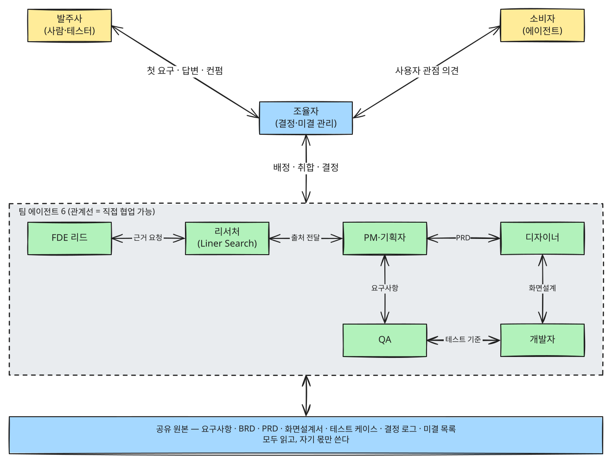

# 에이전트 팀 관계도 — 연결 확정 (2026-11-13)

관련: `docs/plans/2026-11-12_엑스톤_BRD_PRD_초안.md`(꽃집 기준 초안 — 이 문서의 방향 전환으로 일부가 바뀐다)

## 0. 방향 전환 (2026-11-13 사용자 결정)

| 항목 | 결정 |
|---|---|
| 제품 방향 | 기본 에이전트를 제공하고, 사용자가 프롬프트로 에이전트를 직접 만든다. 에이전트마다 **페르소나·프롬프트(역할·지시)·쓸 수 있는 도구·가드레일**을 바꿀 수 있다. 에이전트를 역할별 팀으로 묶어 관계에 따라 연결해 협업시킨다 |
| PoC 범위 | 사용자 요구사항 하나에 맞춘 **고정 팀**으로 문제 인식부터 웹 프로토타입까지 흐름을 먼저 완성한다. 커스터마이징(① 기존 에이전트 수정 ② 프롬프트로 새 에이전트 추가 ③ 팀·연결 자유 구성)은 셋 다 하되 **PoC 완성 뒤 추가 구현**(질문 9). 나중 확장을 위해 에이전트 정의는 처음부터 코드가 아닌 데이터(페르소나·역할·지시·도구·가드레일)로 둔다 |
| 시연 소재 | 팀은 **실제 IT 프로젝트 팀 구조**이고 FDE(고객 현장에서 도메인 문제 인식부터 해결까지)처럼 움직인다. **발주사는 가상 꽃집 「꽃님」**(2026-11-14 사용자 결정 — 11-13 에 정한 가상 쇼핑몰 시나리오는 보류). 기존 꽃집 요청 메모·정답표·검사 스크립트를 그대로 쓴다 |
| 해결의 끝 | 1단계는 **동작하는 웹 프로토타입**까지. QA 에이전트의 실제 테스트 실행은 다음 단계 |
| 발주사 | **사람(앱을 실행하는 테스터)**이 요구사항을 하나씩 입력하고, 문서를 보고 컨펌하면 결과물까지 개발된다 |
| 소비자 | 에이전트(최종 사용자 페르소나) |
| 모드 | **시연 모드**: 가상 시나리오를 실제 모드로 한 번 돌린 기록을 재생(제안: "실제 실행 기록" 표시) · **실제 모드**: 테스터가 직접 입력 |
| 결과물 | 브라우저에서 확인하는 웹 프로토타입(격리된 미리보기). 내려받기는 기본 "HTML + 명세 문서 zip", 여유가 있으면 서버·테스트까지 든 프로젝트 폴더 |
| 팀 | 조율자, FDE 리드, 리서처, PM·기획자, 디자이너, 개발자, QA — **7개 모두** |
| 협업 방식 | **관계를 먼저 그린다.** 첫 요구는 발주사가 주고, 그 뒤 이해관계·결정·미결은 조율자가 처리한다. 문서는 공유하고, 관계로 연결된 에이전트끼리 직접 협업한다 |

## 1. 관계도 (연결 확정 2026-11-13)

## 2. 연결 목록

| 연결 | 오가는 것 | 근거 |
|---|---|---|
| 발주사 ↔ 조율자 | 첫 요구, 질문 카드 답변, 문서 컨펌 | 사용자: "첫 요구는 발주사가 주지만 나머지는 조율자가" |
| 소비자 ↔ 조율자 | 최종 사용자 관점 의견(불편, 포기 지점) | 이해관계 처리는 조율자 몫 |
| 조율자 ↔ 팀 | 작업 배정, 결과 취합, 결정 기록, 미결 추적, 컨펌 필요 시 멈춤 | 같은 근거 |
| FDE 리드 ↔ 리서처 | 도메인 관행·규정 근거 요청과 결과 | Liner Search 사용 지점 |
| 리서처 ↔ PM | 출처가 달린 근거 → 요구사항 우선순위 | |
| PM ↔ 디자이너 | PRD → 화면설계서, 화면에서 나온 빈칸 | |
| PM ↔ QA | 요구사항 → 테스트 케이스, 충돌·빈칸 지적 | |
| 디자이너 ↔ 개발자 | 화면설계서 → 프로토타입 화면 | |
| QA ↔ 개발자 | 테스트 기준 → 프로토타입 확인(실제 실행은 다음 단계) | |
| 팀 ↔ 공유 원본 | 모두 읽고, 자기 몫만 쓴다 | 사용자: "문서는 공유되어야" · 어제 결정 「단일 원본 + 역할별 뷰」 |

## 3. 초안에서 작성자가 정한 것 (2026-11-13 사용자 확인: 고칠 연결 없음, 이대로 확정)
- 발주사·소비자는 팀 에이전트와 **직접 연결하지 않고 조율자만 거친다**. FDE 리드가 발주사와 직접 대화하는 안도 가능하다
- 팀 안 연결 6개는 실제 IT 프로젝트의 일반적인 산출물 흐름을 따랐다. FDE 리드 ↔ PM, 디자이너 ↔ QA 같은 연결은 넣지 않았다
- 연결선이 없는 에이전트끼리는 조율자를 거쳐야 한다고 가정했다

## 4. 남은 질문
- ~~연결 목록 검토~~ → 확정(3절)
- ~~커스터마이징 화면의 범위~~ → PoC 완성 뒤(0절)
- ~~가드레일~~ → 5절
- ~~시연 모드에 쓸 가상 발주사 시나리오~~ → 꽃집(0절). 남은 일: 발주사 역할이 질문에 답할 때 볼 **꽃집 속마음 문서**(결함 10개에 대한 발주사의 답)
- ~~기존 꽃집 자료의 처리~~ → 그대로 사용

## 5. 가드레일 (2026-11-13 확정 — 사용자 필수 3개 + 작성자 추천)

판정 근거는 **에이전트가 스스로 쓴 말이 아니라 시스템이 남긴 기록**으로 한다. 예: "컨펌 받았다"는 에이전트의 보고가 아니라 사람이 버튼을 눌러 생긴 컨펌 기록으로 확인한다.

| # | 가드레일 | 언제 걸리나 | 걸리면 | 시스템이 확인하는 근거 | 출처 |
|---|---|---|---|---|---|
| G1 | **사실 확인** — 확인 안 된 것을 사실로 쓰지 않는다 | 에이전트가 관행·규정·수치·사례를 사실로 적을 때 | 출처가 없으면 "미확인"으로 표시하고 확정 불가 | 문장마다 출처 ID(Liner 검색 결과 또는 발주사 원문) — 그 출처가 저장돼 있고 인용문이 출처에 그대로 있는지 대조 | 사용자 필수 |
| G2 | **컨펌 확인** — 사람 컨펌이 필요한 단계는 컨펌 기록이 있어야 넘어간다 | 문서 확정 전, 개발 시작 전, 변경 반영 전 | 다음 단계 실행을 막고 발주사에게 컨펌 요청 | 사람이 누른 컨펌 기록(누가·언제·어느 버전) | 사용자 필수 |
| G3 | **민감 정보 차단(회사 보안)** | 입력·업로드·생성 결과에 개인정보(주민등록번호·카드번호·전화번호 등), 비밀값(API 키·비밀번호·토큰), 사내 기밀 표시가 보일 때 | 경고하고 저장·전송하지 않음. 가린 값으로만 진행할지 발주사에게 물음 | 패턴 검사 결과 | 사용자 필수 · 대회 규칙 3 |
| G4 | 원문 보호 | 에이전트가 발주사 원문을 고치려 할 때 | 거부. 해석은 별도 항목으로 | 원문 저장본과 현재 값 비교 | 작성자 추천 |
| G5 | 가정 표시 | 근거 없이 에이전트가 값을 채울 때 | 상태 "가정"으로 저장, 컨펌 화면에 따로 모아 보임 | 항목 상태 값 | 작성자 추천 |
| G6 | 생성 코드 격리 | 개발자 에이전트 결과물을 실행할 때 | 격리된 미리보기 창에서만 실행, 외부 네트워크·파일 접근 차단 | 미리보기 창 보안 설정 | 작성자 추천 |
| G7 | 비용·시간 상한 | 한 프로젝트의 LLM 호출 수·경과 시간이 상한을 넘을 때 | 멈추고 발주사에게 알림 | 호출 기록 집계 | 작성자 추천 |
| G8 | 입력 범위 제한 | 요구 규모가 PoC 한계(예: 화면 5개)를 넘을 때 | 범위를 줄이자고 되물음 | 화면설계서의 화면 수 | 작성자 추천 |
| G9 | 용도 검사 | 만들 서비스의 목적이 무기·전쟁 공격 지원·테러와 폭력·성인물과 성매매·불법 행위일 때(요구 입력, 변경 요청) | 저장하지 않고 「만들 수 없는 요청」으로 돌려보냄 | Liner Decisions 판정 확률(해로운 선택지 합 0.5 이상). 판정 모델이 없으면 건너뛰고 기록 | 사용자 요청(2026-11-18) |

- 상한 값(G7 호출 수·시간, G8 화면 수)은 API 키를 받아 실제 응답 시간을 잰 뒤 정한다
