# 사용 가이드

## 1. 이 도구로 무엇을 하나

0to1(영일)은 메모로 받은 요구를 질문으로 구체화하고, 사람이 확인한 내용을 문서와 프로토타입(눌러 보며 확인하는 시제품)으로 만드는 도구입니다.
BRD(왜 만드는지 적은 문서), PRD(무엇을 만드는지 적은 문서), 화면설계서, 테스트 케이스(완료 여부를 확인하는 항목)를 만듭니다.
체크포인트(사람이 확인해야 다음으로 넘어가는 지점)에서 문제와 범위, 요구사항, 문서, 프로토타입을 승인합니다.
확정한 뒤에는 변경의 영향을 살피고, 불만이 기존 약속과 다른 결과인지 새 요청인지 확정 기록과 대조합니다.

## 2. 준비

Python 3.12 이상과 uv가 필요합니다. 화면은 미리 만들어져 있어 실행만 할 때는 Node.js가 필요하지 않습니다. 저장소 폴더에서 다음 명령으로 설치합니다.

```sh
uv sync
```

uv가 없으면 `python3 -m venv .venv`로 가상환경을 만들어 켠 뒤 `pip install -r requirements.txt`로 설치합니다. 이때 서버는 `uvicorn app.main:create_app --factory --port 8000`으로 켭니다.

실제 모드를 쓰려면 Liner에서 발급받은 API 키(서비스 호출에 쓰는 인증 값)가 필요합니다. 저장소 최상위 폴더에 `.env` 파일을 만들고 다음 값을 넣습니다.

| 변수 | 넣을 값 |
|---|---|
| `LINER_API_KEY` | 발급받은 키 |
| `LINER_MODEL` | 권장 값 `liner-claude-router`. `liner-mark-1.3`도 사용 가능 |

```dotenv
LINER_API_KEY=<발급받은 키>
LINER_MODEL=liner-claude-router
```

`.env`는 git에 올라가지 않습니다. 키는 호출할 때마다 읽으므로 서버를 켠 뒤 파일을 만들어도 됩니다. 키 발급과 선택 기능에 쓰는 전체 변수는 [README의 「2. API 키 설정」](../README.md)을 확인합니다.

다음 명령으로 서버를 실행하고 브라우저에서 http://127.0.0.1:8000 을 엽니다.

```sh
uv run uvicorn app.main:create_app --factory --port 8000
```

시작 화면 아래에 「Liner API 키가 준비되어 있어요」가 보이면 실제 모드를 진행할 수 있습니다. 프로젝트 데이터는 `data/exethon.sqlite3`에 저장되며, 나중에 「최근 프로젝트 다시 열기」로 이어 갑니다.

## 3. 키 없이 먼저 보기 (시연 모드)

시작 화면에서 「시연 모드」를 고릅니다. 가상 꽃집 요청으로 진행한 저장된 실행 기록을 재생하며, Liner를 호출하지 않습니다. 위쪽 띠에서 녹화본 종류와 사용 모델, 비용, 걸린 시간을 확인합니다.

재생 버튼이나 스페이스 키로 재생하고, 「다음 장면」과 「이전 장면」으로 이동합니다. 「장면 고르기」에서 필요한 부분을 열거나 「재생 속도」를 바꿉니다. 질문에 답하거나 승인하는 자리는 녹화 당시 사용자가 한 일을 설명하는 안내로 바뀝니다.

메모의 서로 부딪히는 문장에서 시작해 질문, 확인, 문서, 프로토타입, 변경 영향과 판정까지 볼 수 있습니다. 끝 장면의 「시연 녹화본 내려받기 (zip)」를 누르면 zip(여러 파일을 묶은 압축 파일)으로 인쇄용 문서와 프로토타입을 받습니다.

보는 시간은 재생 속도와 고른 장면에 따라 달라집니다. 시연에 나오는 꽃집 「꽃님」과 메모, 답변은 모두 지어낸 가상 데이터입니다.

## 4. 실제 모드 따라 하기

이 절의 장면은 가상 꽃집 「꽃님」의 요청을 실제 Liner API로 진행한 녹화(2026-11-22, `LINER_MODEL=liner-claude-router`)에서 가져왔습니다. 그 한 번의 실행에서 팀이 일한 시간은 합계 약 24분, Liner 호출은 27번, 비용은 $5.31이었습니다. 단계별 비용은 문제 정리 $0.27, 질문 카드 $0.80, 요구사항 확정본 $0.53, 화면 설계까지 $0.25, 문서 작성 $2.17(실패한 호출 뒤 다시 시도한 비용 포함), 프로토타입 $1.30입니다. 사람이 하는 일은 메모 붙여 넣기, 질문 9장 답하기, 확인 4번이고, 나머지 시간은 팀이 일하는 구간입니다. 단계마다 걸린 시간은 따로 재지 않고 합계만 기록했습니다. 같은 소재로 앞서 한 번 더 녹화했을 때는 약 19분, 호출 24번, $3.63이었습니다. 이 숫자는 두 번의 녹화에서 나온 값이며 입력이 다르면 달라집니다.

### 4-1 요구 입력

화면 왼쪽 아래의 작은 설명 상자는 녹화에 들어간 자막입니다.

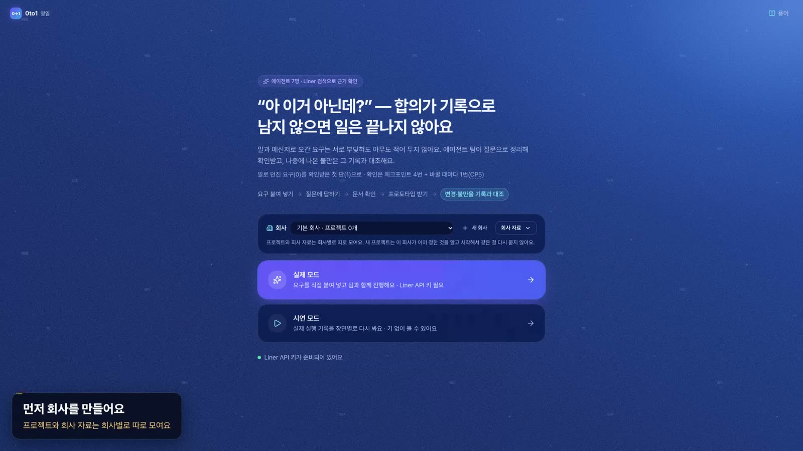

「실제 모드」를 고르면 「어떤 걸 만들고 싶으세요?」와 「요구 메모 1」 입력칸이 보입니다. 시작 화면의 「회사」 줄은 회사 선택 기능을 켠 경우에만 나옵니다.

처음에는 「예제 메모 채우기」를 누릅니다. 꽃집 「꽃님」 사장이 보낸 것으로 만든 가상 요청이 들어갑니다. 꽃 정기구독, 받는 요일, 카드 자동결제, 일시정지 등이 담겨 있습니다. 「배송은 무조건 빨리」와 토요일 일괄 배송처럼 모호하거나 서로 부딪히는 말도 일부러 들어 있습니다.

자신의 요청으로 시작할 때는 받은 메모를 붙여 넣습니다. 「메모 덩어리 추가」로 나누어 넣을 수 있습니다. 이미 쓰는 시스템이 있으면 「우리 시스템 목록」에 이름과 하는 일을 적습니다. 팀은 새로 만들지, 기존 시스템에 더할지, 연계할지 살핍니다.

「회의 녹음 올리기」와 「파일 첨부」도 사용할 수 있습니다. 올릴 수 있는 파일은 다음과 같습니다.

- 녹음은 WAV·MP3·FLAC·M4A·OGG·WebM 형식, 25MB 이하입니다. 받아쓰기 모델 설정이 필요합니다.
- 이미지는 PNG·JPG·GIF·WEBP 형식, 5MB 이하이며 PDF는 15MB 이하입니다. 이미지와 PDF는 최대 5개입니다.
- TXT·MD·CSV는 1MB 이하이며 내용을 그대로 읽습니다.

받아쓰거나 옮겨 적은 글은 원문으로 보관합니다. 내용이 다르면 메모 칸에 바로잡아 적습니다. 준비되면 「팀에게 보내기」를 누릅니다. 버튼이 「확인하는 중…」으로 바뀝니다.

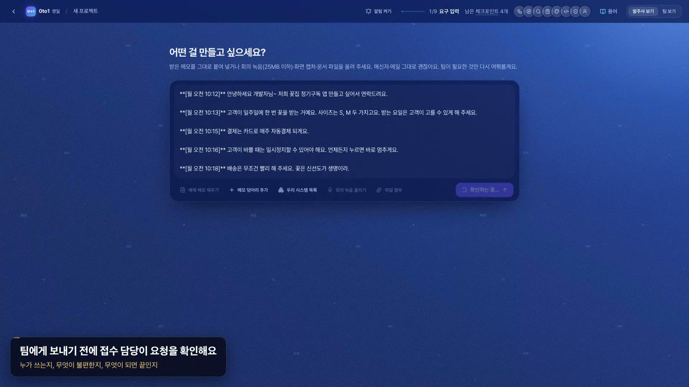

### 4-2 접수 확인

접수 담당은 누가 쓰는지, 무엇이 불편한지, 무엇이 되면 끝인지 확인합니다. 정보가 모자라면 「팀에 넘기기 전에 몇 가지만 여쭤볼게요」와 확인한 내용, 「아직 없어요」 목록이 나옵니다.

답 칸에 빠진 내용을 적고 「답하고 다시 확인하기」를 누릅니다. 앞서 한 답도 함께 보냅니다. 녹화에서는 「무엇이 불편한지」만 되물었고, 답한 뒤 통과했습니다. 내용을 새로 쓰려면 「처음부터 다시 쓰기」를 누릅니다.

「요청을 읽기 어려워요」가 나오면 위 메모를 고쳐 다시 보냅니다. 자음이나 모음만 있는 입력은 Liner를 호출하지 않고 돌려보냅니다. 추가 질문이 나오면 답해야 다음으로 넘어갑니다.

요청이 이 팀의 일이 아니면 「이 팀이 맡을 수 없는 요청이에요」가 나옵니다. 녹화한 예외 입력에서는 이사 짐을 옮겨 달라는 부탁이 이렇게 돌려보내졌습니다.

### 4-3 팀의 문제 정리와 체크포인트 1

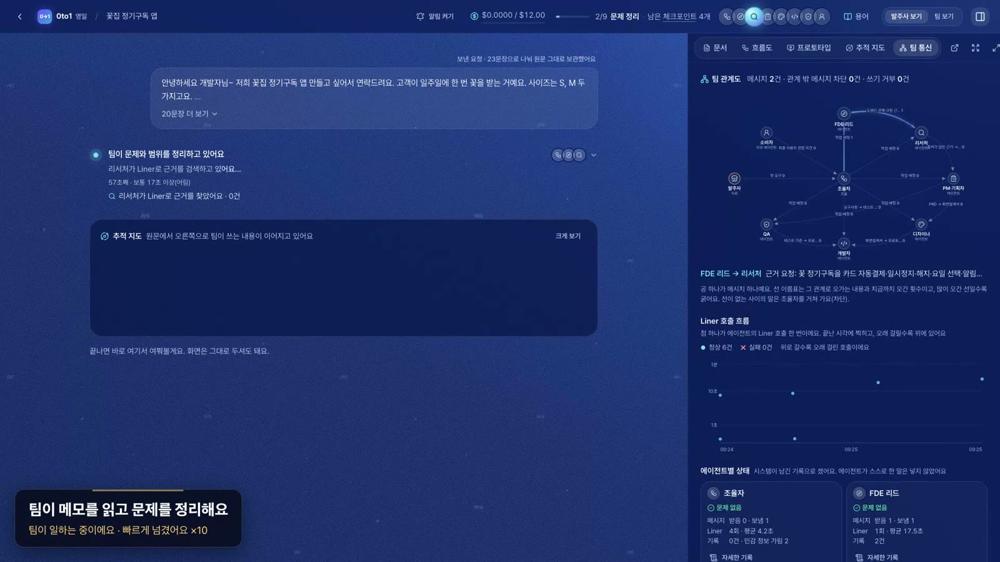

접수가 끝나면 「팀이 문제와 범위를 정리하고 있어요」와 경과 시간이 보입니다. 리서처는 Liner로 근거를 검색합니다. 팀이 일하는 동안 화면은 그대로 두어도 됩니다.

완료되면 「팀이 이해한 문제가 맞는지 봐 주세요」가 나옵니다. 「누가」, 「무엇이 불편한가요」, 「성공 기준」과 이번에 하는 것, 하지 않는 것을 읽습니다. 메모에서 확인한 사실과 팀의 해석도 구분해 봅니다. 「미확인」은 근거 문장이 메모나 출처의 글자와 그대로 맞지 않는다는 표시입니다.

맞으면 「네, 맞아요」를 누릅니다. 다르면 「궁금한 점·고칠 점이 있어요」에 내용을 적고 「보내기」를 누릅니다. 질문에는 답하고, 수정 의견에는 내용을 고쳐 다시 보여 줍니다.

### 4-4 질문 카드

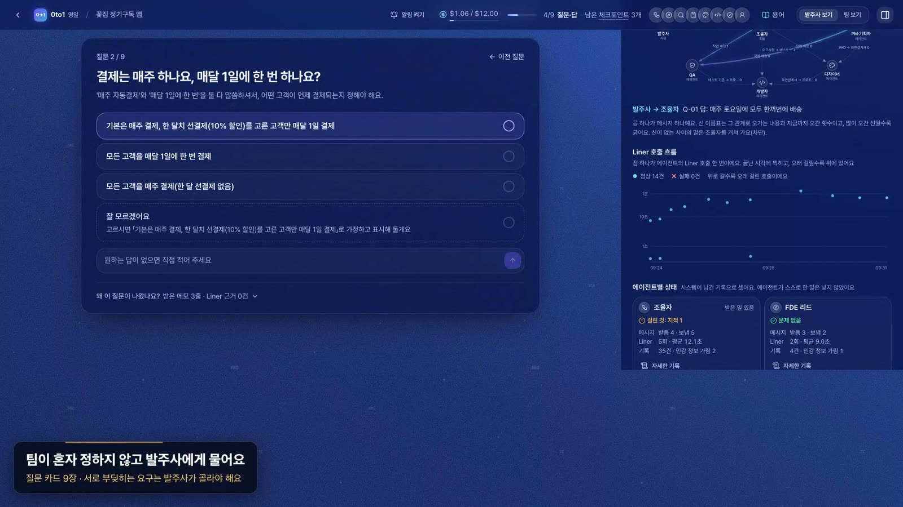

문제와 범위를 승인하면 팀이 빈틈을 찾아 질문을 만듭니다. 카드의 질문과 설명을 읽고 선택지를 고릅니다. 맞는 답이 없으면 「원하는 답이 없으면 직접 적어 주세요」 칸에 답을 씁니다.

결정하기 어려우면 「잘 모르겠어요」를 고릅니다. 팀은 기본 선택지로 가정하고 표시합니다. 서로 부딪히는 요구는 사용자가 골라야 합니다. 「왜 이 질문이 나왔나요?」를 열면 원문 인용과 출처 링크를 볼 수 있습니다.

녹화에서는 질문이 9장이었고, 세 번째 카드에 「잘 모르겠어요」로 답했습니다. 질문 수는 메모에 따라 달라집니다.

### 4-5 답 확인과 팀 기본값

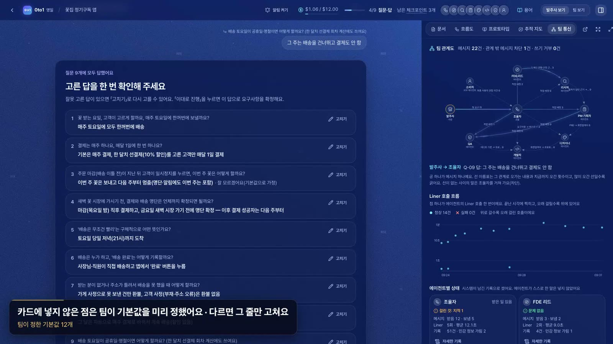

「고른 답을 한 번 확인해 주세요」에서 답을 다시 읽습니다. 잘못 고른 답은 「고치기」로 바꿉니다. 「잘 모르겠어요」로 답한 항목에는 「가정」 표시가 붙습니다.

아래에는 카드로 묻지 않고 팀이 정한 기본값과 이유가 나옵니다. 녹화에서는 기본값이 12개였습니다. 원문이나 흔한 방식을 바탕으로 정한 내용이므로, 원하는 방식과 다른 줄을 고칩니다. 그대로 두면 그 값으로 진행합니다.

검토를 마치면 「이대로 진행」을 누릅니다. 이 기본값도 요구사항과 문서에 들어가므로 답한 목록과 함께 확인합니다.

### 4-6 요구사항 확정, 체크포인트 2

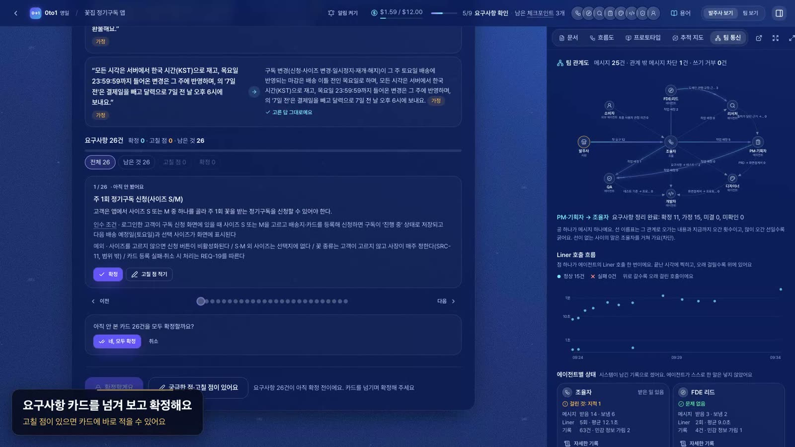

「고른 답으로 정리한 요구사항을 확정할까요?」가 나오면 「내가 고른 답 → 반영된 요구사항」을 확인합니다. 답과 다르게 반영된 내용이 있으면 그대로 승인할 수 없습니다.

카드를 넘기며 제목, 설명, 「인수 조건」과 예외를 읽습니다. 인수 조건은 다 됐다고 판단하는 기준입니다. 맞으면 「확정」을 누르고, 다르면 「고칠 점 적기」에 의견을 남깁니다. 예를 들어 알림을 확인하지 않았을 때 다시 보내 달라는 의견을 적을 수 있습니다.

남은 카드를 한꺼번에 확정할 때는 확인창에서 「네, 모두 확정」을 누릅니다. 고칠 점을 적은 카드는 그대로 남습니다. 수정 의견을 보내면 해당 요구사항을 고쳐 다시 보여 줍니다.

녹화에서는 요구사항이 26건이었습니다. 확정 전인 카드나 보내지 않은 수정 의견이 남으면 전체 승인 버튼을 누를 수 없습니다. 검토를 마친 뒤 「확정할게요」를 누르면 요구사항 원본이 고정되고 문서 작성을 시작합니다.

### 4-7 화면 범위 고르기

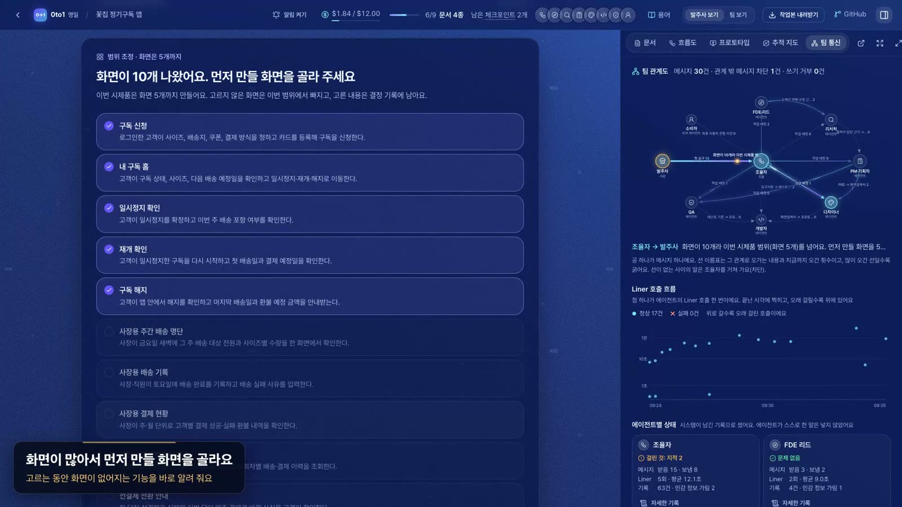

설계한 화면이 상한보다 많으면 먼저 만들 화면을 고르는 카드가 나옵니다. 녹화에서는 화면 10개 중 5개를 골랐습니다. 구독 신청, 내 구독 홈, 일시정지 확인처럼 필요한 화면의 체크 상자를 선택합니다.

선택을 바꿀 때마다 화면이 없어지는 기능의 수가 바뀝니다. 해당 기능은 문서에 남지만 프로토타입에서는 눌러 볼 수 없습니다. 문서 확인 단계에는 화면 범위를 줄여 제외했다는 이유가 미리 채워집니다.

「이 화면들로 진행할게요」를 누르면 선택한 범위로 진행합니다. 모든 화면을 만드는 선택도 가능하지만 생성 시간과 Liner 비용이 늘어납니다.

### 4-8 문서 4종과 체크포인트 3, 빈칸 안내

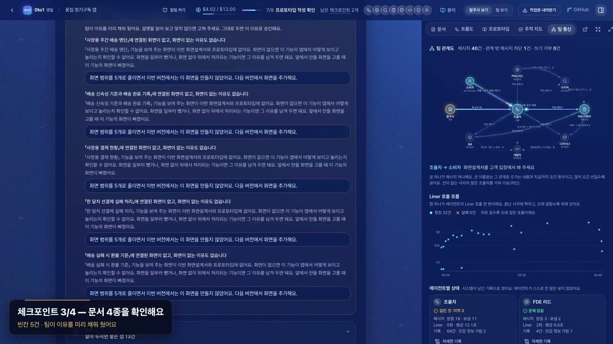

「문서 4종을 보고 프로토타입을 만들까요?」가 나오면 오른쪽 결과물 창의 「문서」를 엽니다. 빈칸 안내가 있으면 이유도 함께 읽습니다. 녹화에서는 빈칸이 5건이었고, 화면 범위를 줄여 해당 화면을 만들지 않았다는 이유가 미리 채워져 있었습니다.

맞지 않는 이유는 고칩니다. 그대로 두면 적힌 이유로 승인 기록이 남습니다. 고른 답과 다르게 적힌 요구사항은 먼저 고쳐야 하며, 빈칸 이유를 쓰는 것으로 넘길 수 없습니다.

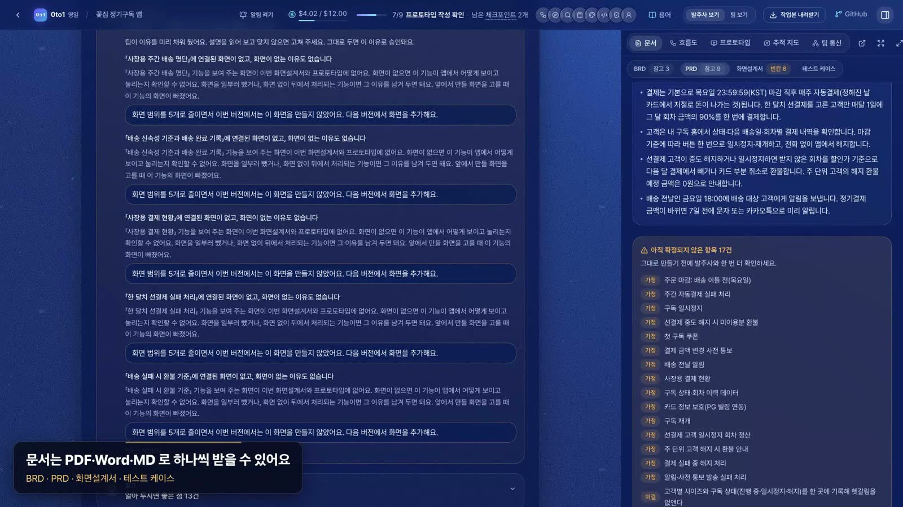

「BRD」에서 문제와 목표, 「PRD」에서 요구사항, 「화면설계서」에서 화면 구성, 「테스트 케이스」에서 완료 여부를 확인하는 방법을 읽습니다. 문서 머리의 승인 상태와 「아직 확정되지 않은 항목」도 살핍니다. 「가정」과 「미결」은 아직 확인하거나 결정할 내용입니다.

문서는 PDF(인쇄용 문서), Word(편집용 문서), MD(마크다운 원문)로 내려받을 수 있습니다. 「크게 보기」와 「새 창으로 보기」로 넓혀 읽어도 됩니다. 검토가 끝나면 「프로토타입 만들어 주세요」를 누릅니다.

문서를 쓰는 동안 QA의 테스트 케이스 작성 호출 하나가 약 200~220초 걸렸고, 이 단계는 Liner 응답이 끊겨 한 번 다시 시도했습니다(8절). 이 값은 녹화 한 번의 기록입니다.

### 4-9 프로토타입과 체크포인트 4

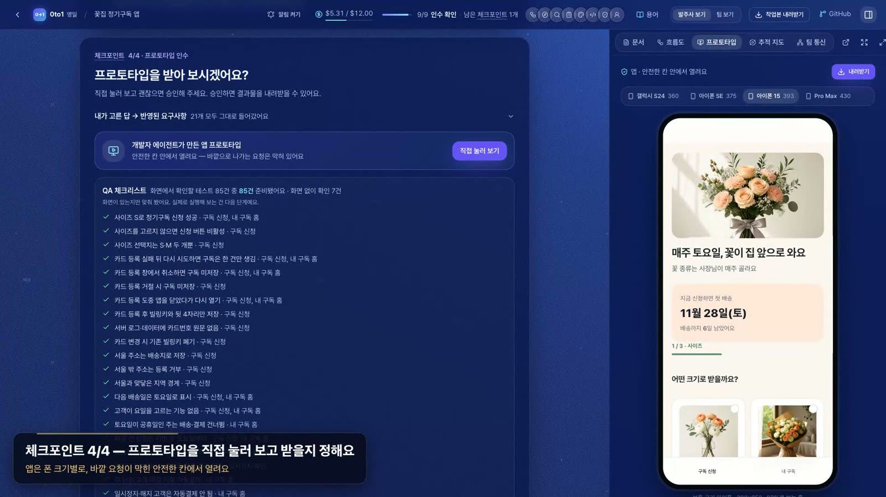

개발자가 프로토타입을 만들고 소비자 역할의 에이전트가 사용 의견을 냅니다. 완료되면 「프로토타입을 받아 보시겠어요?」가 보입니다. 「직접 눌러 보기」를 누르거나 오른쪽 「프로토타입」에서 화면을 확인합니다.

앱 화면은 「갤럭시 S24」, 「아이폰 SE」, 「아이폰 15」, 「Pro Max」로 바꾸어 봅니다. 폰 안의 「구독 신청」과 「내 구독」 등을 눌러 이동하고, 글자가 가려지거나 필요한 동작이 빠졌는지 살핍니다. 녹화 점검에서는 첫 화면 가격이 아래 탭 막대에 가려질 수 있었습니다. 이런 표시 문제도 이 단계에서 확인합니다.

「QA 체크리스트」는 품질 확인 목록입니다. 화면이 있는지를 맞춰 본 결과이며 실제 동작 시험을 끝냈다는 뜻은 아닙니다. 프로토타입은 「안전한 칸 안에서 열려요」라고 표시되는 격리된 공간에서 열리고, 바깥으로 나가는 요청은 막혀 있습니다.

괜찮으면 「받을게요」를 누릅니다. 녹화에서는 개발자의 프로토타입 작성 호출이 185초 걸렸습니다. 상품 사진을 만들지 못하면 그림으로 두고 안내하며, 개발자 응답이 정해진 형식에 맞지 않으면 화면설계서로 만든 대체본을 보여 줍니다.

### 4-10 결과물 내려받기

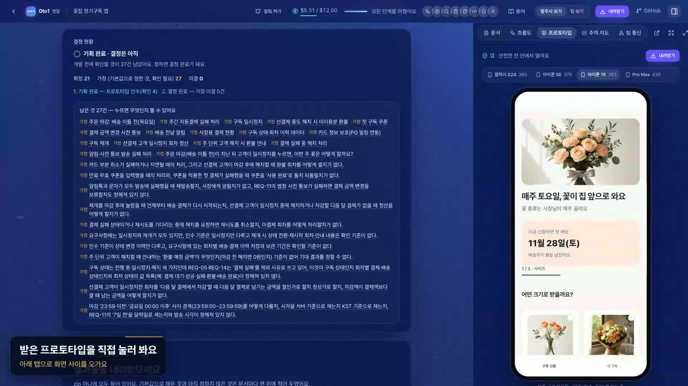

「모든 단계를 마쳤어요」가 보이면 위쪽 「내려받기」나 완료 카드의 「내려받기 (zip)」를 누릅니다. 압축 파일에는 문서 4종, 프로토타입, 상품 사진, 흐름도와 다음 문서가 들어갑니다.

- `AGENTS.md`: AI 코딩 도구가 참고할 목표, 제외 범위, 미정 값, 기존 시스템, 요구사항별 완료 기준과 시험 항목입니다.
- `제안요약.md`: 결재권자나 고객에게 보여 줄 문제, 범위, 기대 효과, 위험과 결정할 내용입니다. 기간과 비용을 임의로 추정하지 않습니다.

녹화에서 받은 파일 이름은 `에이전트팀_결과물.zip`이었습니다. 위쪽 「GitHub」 버튼은 `.env`에 `GITHUB_CLIENT_ID`를 넣어야 켜지며, 없으면 「내려받기(zip)로 받아 주세요」라고 안내합니다.

「결정 현황」도 확인합니다. 녹화 끝에는 확정 21건, 가정 27건, 미결 0건이 남았습니다. 「기획 완료 · 결정은 아직」은 인수를 마쳤어도 기본값으로 둔 가정을 확인해야 한다는 뜻입니다.

압축 파일 생성과 인수 승인은 Liner를 호출하지 않습니다. 승인 전에는 「작업본 내려받기」로 그때까지의 결과를 받을 수 있습니다.

## 5. 확정한 뒤 바꾸고 싶을 때

요구사항을 확정해 버전이 생기면 대화 아래에 입력칸이 나타납니다. 「바꾸고 싶어요」를 고르고, 예를 들어 일시정지를 배송 하루 전까지 허용해 달라고 적습니다. 팀이 대상 요구사항을 찾으면 변경 체크포인트인 CP5가 열립니다. 이 입력칸은 실제 모드에만 있고 시연 재생에는 없습니다. 요청이 확정한 요구와 관련이 없거나 이미 그렇게 되어 있으면 「확정한 요구와 관련 없는 말씀이에요」 또는 「이미 그렇게 돼 있어요」로 알려 줍니다.

「지금」과 「바뀐 뒤」를 비교하고 「함께 다시 봐야 하는 것」에서 연결된 요구사항, 화면, 시험 항목을 확인합니다. 「반영할게요」를 누르면 새 버전으로 고정합니다. 보류하려면 「지금은 그대로 둘게요」를 누르고 이유를 적어 「반려하기」를 누릅니다. 기본 확인은 4번이며 변경할 때마다 CP5를 거칩니다.

기존 약속을 지키지 않은 것으로 보이면 「이거 아닌데요」를 고릅니다. 「아 이거 아닌데?」 대조 결과는 확정본을 기준으로 「합의 위반」 또는 「새 변경 요청」과 근거를 보여 줍니다. 판단 근거가 충분하지 않거나 판정 모델이 없으면 「사람 판단 필요」로 표시합니다.

「합의 위반」은 확정본을 유지하고 결과물을 고쳐야 한다는 판정입니다. 재작업을 자동으로 배정하는 기능까지 이어지지는 않습니다. 「새 변경 요청」이면 「변경 요청으로 바꾸기」로 변경 절차를 시작합니다.

README의 2026-11-16 측정에서는 라우터 모델로 변경 영향 20건을 모두 찾았고, 불만 20건을 모두 맞게 판정했습니다. 각각 3회 측정한 결과이며 모든 입력의 정확도를 보장하지 않습니다.

## 6. 화면 읽는 법

「발주사 보기」는 쉬운 설명을, 「팀 보기」는 요구사항 번호와 근거 번호, 에이전트 활동을 더 보여 줍니다. 위쪽 에이전트 아이콘을 누르면 해당 활동 기록을 봅니다.

「추적 지도」는 원문에서 요구사항, 화면, 시험 항목으로 이어지는 연결입니다. 항목을 누르면 「어디서 왔나」와 「무엇이 기대나」를 확인합니다. 「팀 통신」에서는 호출과 메시지 기록을 되짚어 봅니다.

위쪽 비용 표시는 Liner 크레딧 잔액 차이로 계산한 프로젝트 비용입니다. 누르면 종류별 호출 수와 비용이 나옵니다. 비용 상한을 정했다면 「$3.20 / $5.00」처럼 상한과 막대가 함께 보입니다. 점선 밑줄 낱말에 마우스를 올리면 뜻풀이가 나오고, 「용어」를 누르면 「용어 사전」이 열립니다.

위쪽 「알림 켜기」를 누르면 다른 창을 보고 있어도 처리할 것이 생겼을 때 화면 구석에 알려 줍니다.

## 7. 안전장치와 상한

기본값은 다음과 같고, 모두 제안값입니다. 값을 바꾸는 변수는 [README](../README.md)에 있습니다.

| 안전장치 | 기본값(변수) | 닿으면 보이는 것 |
|---|---|---|
| G7 비용 상한 | 꺼짐(`EXETHON_MAX_COST_USD`) | 「비용 상한에 닿았어요」 |
| G7 호출 상한 | 60회(`EXETHON_MAX_LINER_CALLS`) | 「호출 상한에 닿았어요」 |
| G7 단계 시간 상한 | 600초(`EXETHON_MAX_STAGE_SECONDS`) | 「시간 상한에 닿았어요」 |
| G8 화면 수 상한 | 5개(`EXETHON_MAX_SCREENS`) | 「범위 조정 · 화면은 5개까지」 |

G7 상한에 닿으면 팀이 멈추고 「비용이 커지지 않게 잠시 멈췄어요」가 나옵니다. 「Liner 호출 N회 / 상한 N회」, 「쓴 비용 … / 상한 …」, 「경과 N초 / 상한 N초」 중 해당하는 기록이 함께 붙습니다. 기록을 확인하고 「계속」을 누르면 이어 갑니다. 비용 상한은 단계를 시작하기 전에 그 단계의 보통 비용을 견주어 멈추기도 합니다. 녹화한 실행의 비용 칩은 「$5.31 / $12.00」으로 표시되었습니다.

G8은 화면 수를 줄이는 선택을 받습니다. 빠지는 기능을 확인한 뒤 진행하며, 모든 화면을 만들기로 하면 시간과 비용이 늘어납니다.

G9는 해로운 목적의 요구 입력과 변경 요청을 저장하지 않고 「이 요청은 만들 수 없어요」로 막습니다. 이때는 정보를 가려 보내는 버튼이 없습니다. 판정 모델이 없거나 실패하면 검사를 건너뛰고 기록만 남기므로 모든 실행에서 검사가 수행되는 것은 아닙니다. 녹화한 예외 입력에서는 불법 도박 회원 모집 앱 요청이 「불법 행위」에 해당한다는 안내와 함께 막혔습니다.

G3는 주민등록번호, 카드번호, 전화번호, API 키 같은 형태를 찾으면 「민감 정보가 있어서 아직 보내지 않았어요」로 전송을 멈춥니다. 내용을 확인하고 「가린 값으로 보내기」를 누르면 가린 메모로 접수를 진행합니다. 녹화한 예외 입력에서는 메모에 전화번호를 넣었을 때 이 안내가 나왔고, 「가린 값으로 보내기」 뒤에 접수 확인 질문으로 이어졌습니다. 팀 안에서 오가는 글에도 같은 검사가 돌아가며, 가린 건수는 팀 보기의 에이전트별 상태에 「민감 정보 가림」으로 표시됩니다.

## 8. 자주 묻는 것 / 문제 해결

**키가 없다고 나옵니다.**  
`.env`의 `LINER_API_KEY`를 확인합니다. 파일을 만든 뒤 서버를 다시 켤 필요는 없습니다. 키 없이 보려면 「시연 모드」를 고릅니다. 「서버에 연결할 수 없어요」가 나오면 서버 명령이 실행 중인지 확인합니다.

**모델이 설정되지 않았다고 나옵니다.**  
`.env`에 `LINER_MODEL=liner-claude-router`를 넣습니다. 모델 이름에는 코드 기본값이 없으므로 키와 함께 설정해야 합니다.

**작업 중 Liner 응답이 끊겼습니다.**  
「작업이 멈췄어요」와 오류가 난 단계가 표시됩니다. 「다시 시도」를 누르면 멈춘 단계부터 이어 갑니다. 같은 오류가 반복되면 잠시 뒤 다시 시도합니다. 녹화에서도 문서 작성 중 끊긴 뒤 재시도로 이어 갔습니다. 이미 끝난 호출 일부가 다시 실행되어 비용이 더 들 수 있습니다.

**서버를 켤 때 포트가 사용 중이라고 나옵니다.**  
8000번을 다른 프로그램이나 이미 켜 둔 서버가 쓰고 있는 경우입니다. 이미 켠 서버라면 http://127.0.0.1:8000 을 열면 됩니다. 다른 포트로 켜려면 `uv run uvicorn app.main:create_app --factory --port 8001`을 실행하고 http://127.0.0.1:8001 을 엽니다.

**녹음이 올라가지 않거나 사진 대신 그림이 나옵니다.**  
녹음은 받아쓰기 모델 설정이 필요합니다. 첨부 내용과 확장자가 다르면 해당 안내에 맞춰 파일을 확인합니다. 사진 생성 모델이 없거나 생성에 실패하면 그림으로 두며 진행은 막지 않습니다. 선택 기능의 설정은 [README](../README.md)를 확인합니다.

**나중에 이어 하거나 처음부터 다시 하고 싶습니다.**  
시작 화면의 「최근 프로젝트 다시 열기」로 저장된 작업을 엽니다. 처음부터 진행하려면 새 프로젝트를 시작합니다. 인수를 마쳤더라도 문서 맨 위의 가정과 미결 항목은 별도로 확인합니다.
